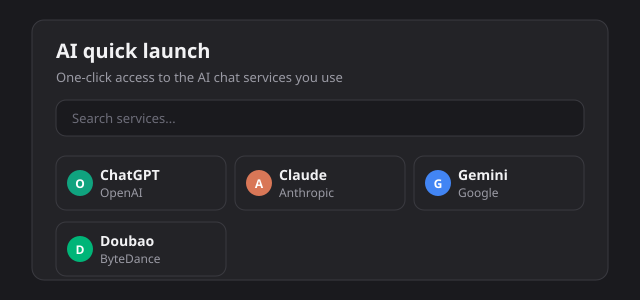

# DSH Agent quick launch

A DeepSeek Harness (DSH) bundle that adds an **AI quick launch** panel to the left sidebar, with one-click access to the chat services of major models.



## Services

| Group | Services |
| --- | --- |
| International | ChatGPT, Claude, Gemini, Grok, Perplexity, Microsoft Copilot, Mistral Le Chat, DeepSeek |
| China | Kimi, Qwen, Doubao, Tencent Yuanbao, ERNIE Bot, Spark, ChatGLM, Hailuo |

Each card opens the service in a new tab through an ordinary `target="_blank"` link, so it works in the browser, the Desktop app, and in-page windows alike. The list is editable: add your own services, edit names, descriptions, URLs, groups, and icons, delete entries, or reset to the defaults. Edits and preferences (recent, pinned) live in the browser's `localStorage` under the `llm-quick-launch/` prefix and are never sent to a DSH service.

## Brand marks

Icons resolve in this order:

1. **Custom icon** — the `Icon` field in **Manage**. A URL, or a local file converted to a data URL.
2. **Simple Icons CDN** — `cdn.simpleicons.org`, kept in memory for the current session only.
3. **Local override** — `logos/<site-id>.svg` for ids listed in `logos/index.json`.
4. **Vendor favicon** — the site's own `/favicon.ico`, when that path serves an image.
5. **Resolver** — `a.favicon.im/<host>`, for sites whose `/favicon.ico` answers with HTML.
6. **Built-in** — the inline SVG or character in `client.js`.

**Network notice.** Steps 2 and 5 make requests from your browser to `cdn.simpleicons.org` and `a.favicon.im` (the latter receives the hostname of each service whose favicon is requested). Nothing else is sent. Give every site a custom icon, or use a local override, to keep the panel free of third-party requests; the panel never fails to render when those requests are blocked.

Adding your own mark: drop a white-on-transparent `<id>.svg` into `logos/`, add `"<id>"` to `logos/index.json`, and reload. See [`logos/README.md`](logos/README.md).

Built-in brand paths are monochrome renditions of [Simple Icons](https://simpleicons.org) artwork (CC0 1.0). All trademarks belong to their owners.

## Refresh

The **Refresh** button in the panel header clears the in-session logo memory and local overrides, then re-requests every mark. It never touches the service list, recents, pins, or custom icons.

## Install

```sh
# linked checkout
dsh plugin --profile <name> add /path/to/llm-quick-launch

# from git
dsh plugin --profile <name> add github:cosmos-voyage/dsh-llm-quick-launch

# packed tarball
pnpm pack
dsh plugin --profile <name> add ./cosmos-voyage-llm-quick-launch-1.0.0.tgz
```

This bundle is plain JavaScript with no build step, so git installs need no `prepare` build approval. Verify the layer without starting:

```sh
dsh --profile <name> --dump-config
```

## Requirements

- DSH `>=0.2.0 <0.3.0`, as declared in `engines.dsh`.
- The Web UI. The Host half has no behavior of its own.

## License

MIT. Brand marks are the trademarks of their respective owners and are not covered by that license; see `LICENSE` for the third-party notice.
