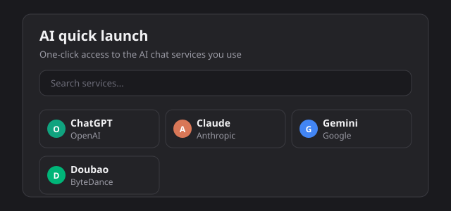

# DSH 大模型快捷入口

为 DeepSeek Harness（DSH）左侧栏添加一个 **大模型快捷入口** 面板，一键打开各大模型的对话页面。



## 站点

| 分组 | 站点 |
| --- | --- |
| 国际 | ChatGPT、Claude、Gemini、Grok、Perplexity、Microsoft Copilot、Mistral Le Chat、DeepSeek |
| 国内 | Kimi、通义千问、豆包、腾讯元宝、文心一言、讯飞星火、智谱清言、海螺 AI |

每张卡片都是普通的 `target="_blank"` 链接，在新标签页打开，浏览器、桌面应用和页面内窗口都能正常工作。

站点可编辑：新增、修改名称/说明/网址/分组/图标、删除，或恢复默认。编辑结果和「最近使用」「置顶」偏好保存在浏览器 `localStorage` 的 `llm-quick-launch/` 前缀下，不会发送给任何 DSH 服务。

## 图标

图标按以下顺序解析：

1. **自定义图标** —— 「管理」中的「图标」字段，可填 URL 或把本地文件转成 data URL；
2. **Simple Icons CDN** —— `cdn.simpleicons.org`，仅在当前会话的内存中保留；
3. **本地覆盖** —— `logos/index.json` 中登记的 `logos/<站点 id>.svg`；
4. **厂商 favicon** —— 站点自己的 `/favicon.ico`（该路径确实返回图片时）；
5. **解析服务** —— `a.favicon.im/<域名>`，用于 `/favicon.ico` 返回 HTML 的站点；
6. **内置** —— `client.js` 里的内联 SVG 或汉字。

**网络说明。** 第 2 和第 5 步会让你的浏览器向 `cdn.simpleicons.org` 和 `a.favicon.im` 发起请求（后者会收到被请求图标的站点域名），除此之外不发送任何内容。为每个站点设置自定义图标或本地覆盖，即可完全避免第三方请求；这些请求被拦截时面板仍能正常显示，只会回退到内置图标。

自定义图标：在 `logos/` 放一个白色前景、透明背景的 `<id>.svg`，把 `"<id>"` 加进 `logos/index.json`，刷新页面即可，详见 [`logos/README.md`](logos/README.md)。

内置品牌路径来自 [Simple Icons](https://simpleicons.org)（CC0 1.0）的图标形状。所有商标归各自所有者。

## 刷新

面板标题栏的 **刷新** 按钮会清空当前会话的图标内存与本地覆盖，然后重新请求全部图标；不会改动站点列表、最近使用、置顶和自定义图标。

## 安装

```sh
# 链接本地目录
dsh plugin --profile <name> add /path/to/llm-quick-launch

# 从 git 安装
dsh plugin --profile <name> add github:cosmos-voyage/dsh-llm-quick-launch

# 从打包的 tarball 安装
pnpm pack
dsh plugin --profile <name> add ./cosmos-voyage-llm-quick-launch-1.0.0.tgz
```

本项目是纯 JavaScript，无需构建步骤，从 git 安装时也不需要授权 `prepare` 脚本。可以先不启动、只检查这一层：

```sh
dsh --profile <name> --dump-config
```

## 要求

- DSH `>=0.2.0 <0.3.0`（见 `engines.dsh`）；
- Web UI。Host 端本身没有行为。

## 许可

MIT。品牌标识属于各自所有者，不在 MIT 许可范围内，见 `LICENSE` 中的第三方声明。
